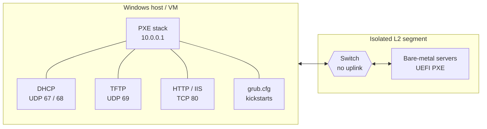
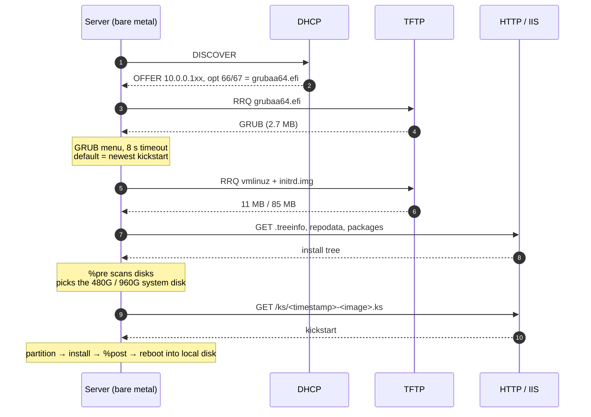
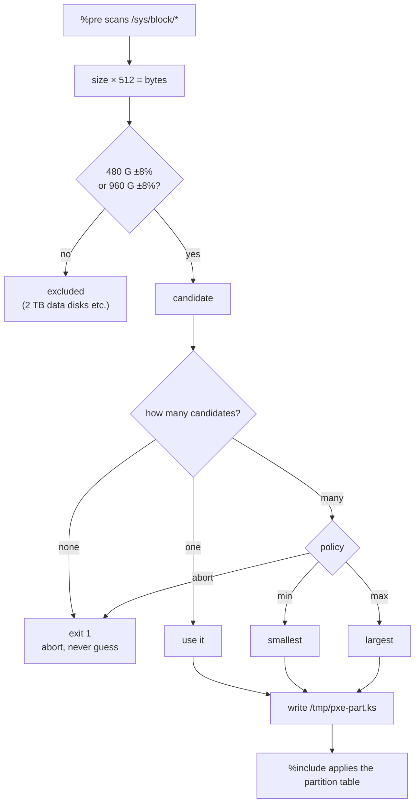

<div align="center">


<br>

[](#requirements)
[](#requirements)
[](LICENSE)
[](#contributing)

**English** · [简体中文](README.zh-CN.md)

*Turn one Windows box into a zero-touch PXE provisioning server for bare-metal Linux installs.*

</div>

---

## Highlights

| | |
|---|---|
| **One-command install** | `install.ps1` provisions DHCP, IIS, TFTP, firewall rules, self-healing tasks and desktop shortcuts |
| **Zero-touch clients** | The console writes a kickstart and makes it the default GRUB entry — the client installs after an 8 s countdown |
| **System disk auto-detect** | `%pre` picks the disk by **capacity** (480 G / 960 G profiles), any other disk size is excluded |
| **Custom partitioning** | Add rows in a grid: mount point, size, filesystem, grow-to-fill |
| **Survives reboots** | `PXE-Health` re-creates the IP, services, site, TFTP process and firewall rules at every boot |
| **No third-party runtime** | The TFTP server is ~200 lines of C# compiled at install time — no tftpd32, no Nginx, no WSL |

---

## Architecture



| Service | Port | Responsibility |
|---|---|---|
| DHCP | `UDP 67/68` | Lease + option 66 (server) and 67 (boot file) |
| TFTP | `UDP 69` | Ships `grubaa64.efi`, `vmlinuz`, `initrd.img` |
| HTTP (IIS) | `TCP 80` | Full ISO tree for `inst.repo` + kickstart files |

> **Network rule:** the provisioning NIC must sit on an isolated segment. A DHCP server on an office LAN
> will race the corporate DHCP and hand out addresses to desktops.

---

## How a boot actually goes



---

## Requirements

- Windows Server **2016 / 2019 / 2022**, run as **Administrator**
- A dedicated switch (or direct cable) — **no uplink** to the office network
- Target servers must support **UEFI PXE** (ARM64 boards use `grubaa64.efi`)
- Disk space: roughly 5–8 GB per imported ISO

---

## Quick start

```powershell
# 1 — install the whole stack
.\install.ps1 -ServerIp 10.0.0.1 -ScopeId 10.0.0.0 -NicAlias Ethernet2

# 2 — drop ISOs into C:\PXE\iso and expand them
cd C:\PXE
.\Import-PxeIso.ps1 -Iso "C:\PXE\iso\*.iso"

# 3 — open "PXE Console", fill the form, press "build ks and apply"

# 4 — boot the target once with PXE; it installs unattended
```

| Parameter | Default | Meaning |
|---|---|---|
| `-ServerIp` | `10.0.0.1` | Address of the provisioning NIC |
| `-ScopeId` | `10.0.0.0` | DHCP scope (assumes /24) |
| `-RangeStart` / `-RangeEnd` | `.100` / `.200` | Lease pool |
| `-PxeRoot` | `C:\PXE` | Install root |
| `-NicAlias` | *(auto)* | Adapter that must carry `ServerIp` |
| `-SkipDhcp` | off | Skip DHCP (existing server / proxyDHCP) |

Removal: `.\uninstall.ps1` — add `-RemoveData` to delete `C:\PXE` as well.

---

## Adding images

```powershell
cd C:\PXE
.\Import-PxeIso.ps1 -Iso "C:\PXE\iso\*.iso"
```

For every ISO the script will:

1. mount it and mirror the whole tree to `www\os\<slug>`
2. extract `vmlinuz` / `initrd.img` into `tftproot\images\<slug>`
3. lift the distro's `EFI/BOOT/grubaa64.efi` as the network boot program
4. rebuild the GRUB menu
5. add the IIS MIME mappings that anaconda needs (`.treeinfo`, `.zst`, `.ks`, …)

> Re-running expands **every** ISO in `iso\`. To add just one, pass its filename.

---

## Console

<p align="center"></p>

| Tab | What it controls |
|---|---|
| **System & network** | Architecture (ARM64 / x64), image, DHCP or static IP, timezone, locale |
| **Accounts** | `root` password, optional sudo user |
| **Disks** | Disk selection (capacity auto-detect or fixed) + automatic or custom partition table |
| **Packages** | Minimal, GUI server, or a custom package list |

Pressing **Build ks and apply** generates the kickstart, rewrites the GRUB menu with the new entry as
default, and flips the DHCP boot file to match the selected architecture.

---

## System disk detection

The PXE server cannot see the client's disks — the OS is not installed yet. So the decision runs
**inside the installer**, in the kickstart `%pre` section:



- Whitelist and tolerance are editable in the console (`480, 960` and `8%` by default)
- The generated `%pre` must stay **before** `%include` — anaconda executes pre scripts while parsing
- Nothing matches → the installer aborts with a readable message instead of wiping the wrong disk

---

## Boot-time self-healing

| Component | How it comes back |
|---|---|
| DHCP / IIS / WinRM | Windows services, `Automatic` |
| TFTP | Scheduled task `PXE-TFTP` (SYSTEM, at startup, restart-on-failure) |
| Site `PXE` | `serverAutoStart = true`; the default site is stopped so it cannot steal port 80 |
| `PXE-Health` | 30 s after boot: re-adds the IP, starts services, starts the site, starts TFTP, re-adds firewall rules |

Log: `C:\PXE\logs\health.log`

---

## Repository layout

```
.
├─ install.ps1            one-shot deployment
├─ uninstall.ps1          clean removal (-RemoveData to wipe C:\PXE)
├─ PXEConsole.ps1         WinForms console
├─ Import-PxeIso.ps1      ISO → PXE-bootable HTTP + TFTP layout
├─ lib\
│  ├─ PxeLib.ps1          kickstart builder, menu rebuild, disk-detect template
│  └─ PxeHealth.ps1       boot-time self heal
├─ src\
│  └─ TftpServer.cs       RFC 1350 TFTP server (blksize / tsize / timeout)
└─ docs\
   ├─ banner.svg
   └─ screenshot.png
```

Runtime layout created by the installer:

```
C:\PXE
├─ www\            IIS root
│  ├─ os\<slug>\   expanded ISO (repodata, Packages, images)
│  └─ ks\          generated kickstarts
├─ tftproot\       grubaa64.efi, images\*, EFI\
├─ tftpd\tftpd.exe compiled TFTP server
├─ iso\            drop ISOs here
├─ lib\            PxeLib.ps1, PxeHealth.ps1
└─ logs\           tftp.log, health.log
```

---

## Troubleshooting

| Symptom | Cause / fix |
|---|---|
| Stuck at `DHCP...` | Switch is not on the same L2, or the provisioning NIC has no IP — run the `PXE-Health` task |
| Lease OK, then `TFTP timeout` | `Get-Process tftpd`, check inbound UDP 69 |
| Lands in `grub>` prompt | Type `configfile (tftp)/EFI/BOOT/grub.cfg`; if that fails the board's GRUB prefix is unusual |
| `no disk matches capacity rules` | Target disk is outside the whitelist — adjust it or switch to a fixed disk |
| `multiple candidate disks` | Several 480/960 G disks present — set the policy to min/max, or pin the disk |
| `%include: file not found` | `%pre` ended up after `%include` — regenerate the kickstart with the console |
| Install source 404 | IIS site state, `www\os\<slug>` presence, missing MIME mapping |
| Reboot loops back into PXE | Firmware prefers network boot. The kickstart `%post` already pushes the local EFI entry first; otherwise fix the BIOS boot order |

---

## Limitations

- Unattended flow targets **anaconda** (Kylin / openEuler / RHEL family). Ubuntu `casper` gets a menu entry only.
- ARM64 images only boot ARM64 machines; x64 images need `grubx64.efi`.
- The kickstart stores `root` passwords with `--plaintext` — hash them for production use.
- The provisioning segment must stay isolated.

---

## Contributing

Issues and pull requests are welcome. Please keep the scripts ASCII-safe where possible and test on a
real server before opening a PR.

## License

[MIT](LICENSE)
