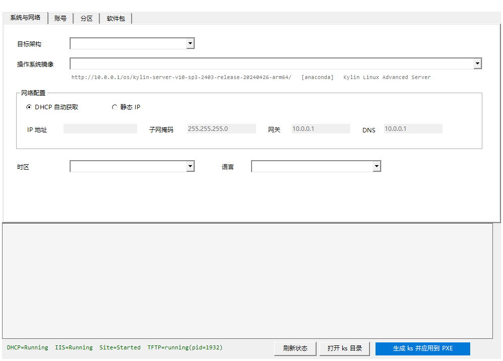

# PXE 装机服务器（Windows Server 一键部署）

在 **Windows Server 2016/2019/2022** 上用一套脚本把 PXE 装机环境整套搭起来：
DHCP + TFTP + HTTP + 一个图形化控制台，给裸机服务器**无人值守**装 Linux（麒麟 / openEuler / RHEL 系）。

目标：**目标机开机 → 8 秒自动进安装 → 装完自动重启进系统**，全程不碰服务器。



---

## 特性

| 能力 | 说明 |
|---|---|
| 一键部署 | `install.ps1` 装角色、编译 TFTP、配 DHCP/IIS、注册自愈任务、建快捷方式 |
| 无人值守 | 控制台生成 kickstart 并自动设为 GRUB 默认项，倒计时结束即安装 |
| 系统盘自动识别 | ks 的 `%pre` 在装机瞬间按**容量**挑盘（默认 480G / 960G 两档 ±8%），其他容量一律排除 |
| 自定义分区 | 表格里加行即可（挂载点 / 容量 / 文件系统 / 是否占满剩余） |
| 开机自愈 | 重启后自动补齐 IP、服务、站点、TFTP、防火墙，掉线自己爬起来 |
| 多架构 | ARM64(aarch64) / x64 分开导入，DHCP 引导文件随所选架构切换 |
| 无外部依赖 | TFTP 服务用 C# 自实现（`src/TftpServer.cs`），不需要装第三方软件 |

---

## 组件与端口

| 组件 | 端口 | 作用 |
|---|---|---|
| DHCP | UDP 67/68 | 下发地址 + option 66/67 指向引导文件 |
| TFTP | UDP 69 | 传输 `grubaa64.efi` / `vmlinuz` / `initrd.img` |
| HTTP (IIS) | TCP 80 | 提供 ISO 全量目录（`inst.repo`）和 ks 文件 |

默认目录（可改 `-PxeRoot`）：

```
C:\PXE
├─ www\            IIS 站点根
│  ├─ os\<slug>\   ISO 展开后的安装源（含 repodata）
│  └─ ks\          生成的 kickstart
├─ tftproot\       TFTP 根（grubaa64.efi / images\ / EFI\）
├─ tftpd\tftpd.exe 自编译的 TFTP 服务
├─ iso\            放原始 ISO
├─ lib\            PxeLib.ps1 / PxeHealth.ps1
└─ logs\           tftp.log / health.log
```

---

## 环境要求

- Windows Server 2016/2019/2022，**管理员权限**
- 一台**独立/隔离**的二层交换机（或直连），PXE 服务器与目标机在同一广播域
- 目标机支持 **UEFI PXE**（ARM64 服务器走 UEFI PXE + `grubaa64.efi`）
- 磁盘：每套 ISO 展开后约 5–8 GB

> ⚠️ **不要**把装机网卡接在办公网上：本机会发 DHCP，会把办公网的机器抢走。

---

## 快速开始

```powershell
# 1. 部署
.\install.ps1 -ServerIp 10.0.0.1 -ScopeId 10.0.0.0 -NicAlias Ethernet2

# 2. 把 ISO 放进 C:\PXE\iso，然后展开
cd C:\PXE
.\Import-PxeIso.ps1 -Iso "C:\PXE\iso\*.iso"

# 3. 打开桌面「PXE Console」，填表 → 生成 ks 并应用

# 4. 目标机 UEFI 里把网络启动设为第一，开机
```

`install.ps1` 参数：

| 参数 | 默认 | 说明 |
|---|---|---|
| `-ServerIp` | `10.0.0.1` | 装机网段上本机的地址 |
| `-ScopeId` | `10.0.0.0` | DHCP 作用域网段（/24） |
| `-RangeStart` / `-RangeEnd` | `.100` / `.200` | 地址池 |
| `-PxeRoot` | `C:\PXE` | 安装目录 |
| `-NicAlias` | 空 | 承载 ServerIp 的网卡名，留给自愈任务用 |
| `-SkipDhcp` | — | 已有 DHCP 或要走 proxyDHCP 时跳过 |

卸载：`.\uninstall.ps1`（加 `-RemoveData` 连目录一起删）。

---

## 导入镜像

```powershell
cd C:\PXE
.\Import-PxeIso.ps1 -Iso "C:\PXE\iso\*.iso"
```

脚本会自动：挂载 ISO → 全量解包到 `www\os\<slug>` → 抽 `vmlinuz`/`initrd` 到 `tftproot\images\<slug>`
→ 抽发行版 `EFI/BOOT/grubaa64.efi` 作引导文件 → 重建 GRUB 菜单 → 补 IIS 的 MIME 映射。

> 重跑会对 `iso\` 下所有 ISO 重新展开；只加一个就写具体文件名。

---

## 控制台

桌面/开始菜单「PXE Console」。四个页签：

- **系统与网络**：架构（ARM64 / x64）、镜像、DHCP 或静态 IP、时区、语言
- **账号**：root 密码、可选普通用户 + sudo
- **分区**：磁盘选择（按容量自动识别 / 指定磁盘）、自动分区 / 自定义分区表
- **软件包**：最小化 / 带图形界面 / 自定义

点「生成 ks 并应用到 PXE」后：生成 ks → 重建菜单并把新条目设为默认 → 切换 DHCP 引导文件。

---

## 系统盘按容量识别

服务器端看不到目标机磁盘（系统还没装），所以判定放在 kickstart 的 `%pre` 里，装机瞬间执行：

1. 遍历 `/sys/block`，用 `size * 512` 算真实容量
2. 命中白名单（默认 `480 960` GB，容差 ±8%）才算系统盘，其余（如 2T 数据盘）排除
3. 命中 1 块 → 用它；多块 → 按策略：中止（默认）/ 选最小 / 选最大
4. 一块都没命中 → `exit 1`，安装中止并写日志，**不会瞎装**

判定结果写入 `/tmp/pxe-part.ks`，主 ks 用 `%include` 引用。
`%pre` 必须排在 `%include` 之前（anaconda 边解析边执行 pre 脚本），生成器已保证顺序。

白名单和容差都在界面里改。

---

## 开机自启与自愈

| 组件 | 方式 |
|---|---|
| DHCP / IIS / WinRM | 服务 Automatic |
| TFTP | 计划任务 `PXE-TFTP`（SYSTEM，开机启动，崩溃自动重启） |
| IIS 站点 `PXE` | serverAutoStart=True；默认站点停用以避免抢 80 端口 |
| `PXE-Health` | 开机延迟 30s 自检：补 IP、起服务、起站点、起 TFTP、补防火墙 |

自愈日志：`C:\PXE\logs\health.log`

---

## 排错

| 现象 | 处理 |
|---|---|
| 卡 `DHCP...` | 交换机不在同一 L2；或装机网卡没有 ServerIp（跑一次 `PXE-Health`） |
| 有地址但 TFTP 超时 | `Get-Process tftpd`；防火墙 UDP 69 |
| 进 `grub>` 提示符 | 手输 `configfile (tftp)/EFI/BOOT/grub.cfg`；仍不行说明该主板 grub prefix 特殊 |
| `no disk matches capacity rules` | 目标盘容量不在白名单；改白名单/容差，或切「指定磁盘」 |
| `multiple candidate disks` | 多块 480/960G 盘；策略改选最小/最大，或指定磁盘 |
| `%include` 文件找不到 | `%pre` 被排到了 `%include` 后面，用工具重新生成 |
| 安装源 404 | IIS 站点状态；`www\os\<slug>` 是否存在；MIME 是否缺 |
| 装完又进 PXE 循环重装 | 固件强制网络优先。ks 的 `%post` 已把本地 EFI 引导项置顶，仍不行就改 BIOS 启动顺序 |

---

## 已知限制

- 本仓库只处理 **RHEL 系（anaconda）** 的无人值守；Ubuntu `casper` 有基础菜单项但未做自动化验证。
- ARM64 镜像只能装 ARM64 机器，x64 镜像需要对应架构的引导文件（`grubx64.efi`）。
- ks 里密码使用 `--plaintext`，生产环境建议改为加密哈希。
- 装机网段必须是隔离的，否则 DHCP 会冲突。

## License

MIT
