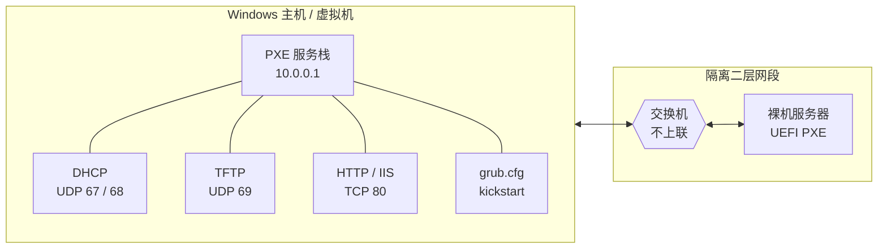
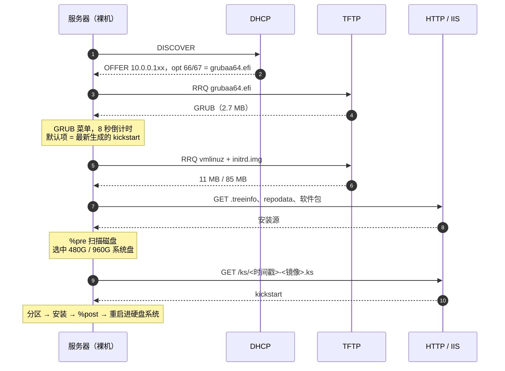
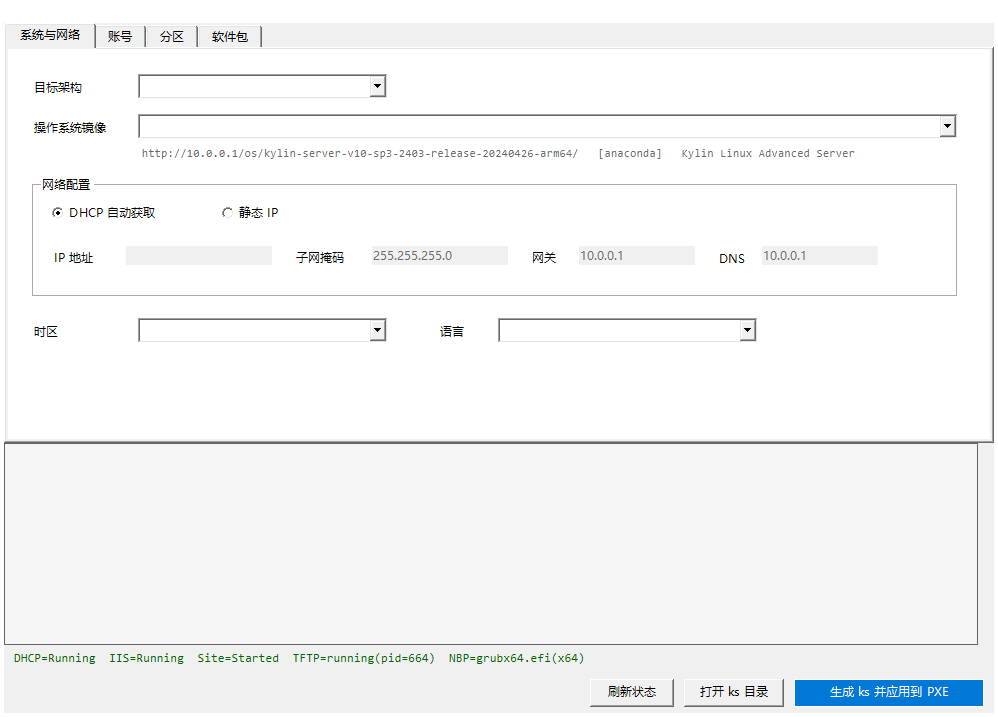
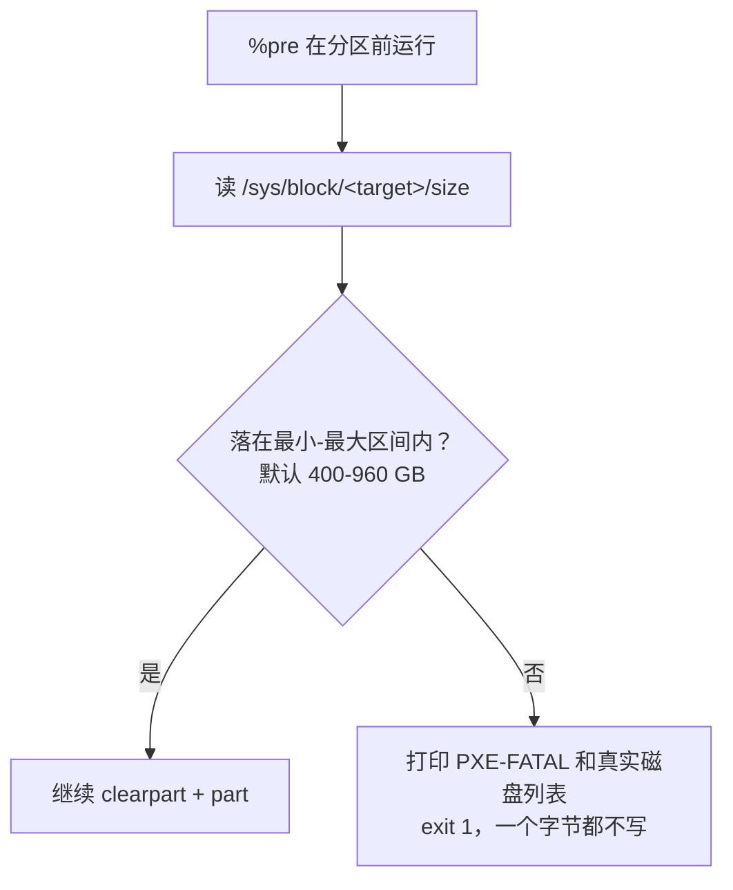

<div align="center">


<br>

[](#环境要求)
[](#环境要求)
[](LICENSE)
[](#参与贡献)

[English](README.md) · **简体中文**

*用一台 Windows 机器，把裸机 Linux 装机变成全自动。*

</div>

---

## 亮点

| | |
|---|---|
| **一条命令部署** | `install.ps1` 装好 DHCP、IIS、TFTP、防火墙、自愈任务和桌面快捷方式 |
| **客户端零操作** | 控制台生成 kickstart 并设为 GRUB 默认项，目标机倒计时 8 秒后自动开装 |
| **系统盘容量校验** | `%pre` 校验目标磁盘容量是否落在 **400-960 GB** 区间（可改），超出直接中止 |
| **自定义分区** | 表格加行即可：挂载点、容量、文件系统、是否占满剩余 |
| **重启不丢服务** | `PXE-Health` 每次开机自动补齐 IP、服务、站点、TFTP 进程和防火墙规则 |
| **无第三方运行时** | TFTP 服务是约 200 行 C#，安装时编译，不用 tftpd32、不用 Nginx、不用 WSL |

---

## 架构



| 服务 | 端口 | 作用 |
|---|---|---|
| DHCP | `UDP 67/68` | 下发地址 + option 66（服务器）与 67（引导文件） |
| TFTP | `UDP 69` | 传输 `grubaa64.efi`、`vmlinuz`、`initrd.img` |
| HTTP (IIS) | `TCP 80` | 提供 ISO 全量目录（`inst.repo`）和 ks 文件 |

> **网络前提**：装机网卡必须接在隔离网段上。DHCP 服务器接在办公网会和公司 DHCP 抢地址，
> 把地址发给普通办公电脑。

---

## 一次开机的完整流程



---

## 两种场景：物理机装机 与 虚拟机自测

这套服务一次只服务**一个网段**——它装机网卡所在的那个二层域。所有从它启动的机器都必须和它同段；
而安装源地址是写死在 GRUB 菜单里的，所以换网段就要换菜单。

| | 物理机（生产） | 虚拟机（本机自测） |
|---|---|---|
| 网段 | `10.0.0.0/24`，`VMnet0` 桥接到有线网卡，接隔离交换机 | `192.168.100.0/24`，`VMnet2` 仅主机 |
| 服务端地址 | `10.0.0.1`（工具默认） | `192.168.100.10` |
| 引导文件 | `grubaa64.efi`（ARM64）/ `grubx64.efi`（x64） | `grubx64.efi` |
| 磁盘名 | SAS/SATA 背板是 `sda`，NVMe 是 `nvme0n1` | VMware NVMe 是 `nvme0n1`，SATA 虚拟盘是 `sda` |
| 怎么启动 | BMC 设一次性 PXE，或改 BIOS 启动顺序 | UEFI Boot Manager 里选 *EFI Network* |

### 物理机

1. 服务器和 Windows 主机都接到**隔离交换机**，不要上联办公网，否则本机 DHCP 会应答办公电脑。
2. 在 BMC 里设一次性 PXE 启动，然后上电：

```http
PATCH /redfish/v1/Systems/1     （Basic 认证，或用 X-Auth-Token：
                                 先 POST /redfish/v1/SessionService/Sessions）

{"Boot":{"BootSourceOverrideTarget":"Pxe",
         "BootSourceOverrideEnabled":"Once",
         "BootSourceOverrideMode":"UEFI"}}
```

   华为 iBMC 上这个 PATCH 可能返回 `412` 但实际已生效——读回来确认
   `BootSourceOverrideTarget` 是 `Pxe` 即可。该设置只在**关机状态**下才能改，
   需要的话先 `ForceOff`。

3. 服务器拿到 `10.0.0.1xx` → 加载 GRUB → 8 秒后自动安装 → 装完重启进新系统。
4. 控制台里的磁盘名要按硬件填（`sda` / `nvme0n1` / `vda`）。

### 虚拟机自测

1. 建虚拟机时选：**仅主机 VMnet2**、**UEFI** 固件、**e1000e** 网卡、**480 GB** 精简磁盘。
   容量校验只接受 400-960 GB，且 `vmxnet3` 在 UEFI PXE 下经常起不来。
2. 安装源要指向 VMnet2 的地址，而不是生产的：
   - 生成 ks 时把 `ServerIp` 设为 `192.168.100.10`
   - 在 `grub.cfg` 旁边放一份 `grub.cfg-01-<MAC>`，内容把 `10.0.0.1` 全替换成 `192.168.100.10`
     （GRUB 会先请求这个按 MAC 命名的文件；TFTP 对缺失的 `grub.cfg-*` 会回落到主菜单，
     所以存在的那份优先）
3. 开机进 Boot Manager 选 **EFI Network**，之后和物理机完全一样。
4. VMware 的 NVMe 盘在系统里叫 `nvme0n1`，SATA 盘才是 `sda`；名字填错会在解析阶段直接报
   `Disk "sda" given in ignoredisk command does not exist`。

> 测试虚拟机和生产服务器不同网段时，不可能共用同一份菜单。要么把测试机接进生产网段，
> 要么就按上面的办法单独给它一份按 MAC 的菜单。

---
## 环境要求

- Windows Server **2016 / 2019 / 2022**，以**管理员**身份运行
- 一台专用交换机（或直连），**不能上联**办公网
- 目标机支持 **UEFI PXE**（ARM64 主板使用 `grubaa64.efi`）
- 磁盘空间：每个导入的 ISO 约占 5–8 GB

---

## 快速开始

```powershell
# 1 — 部署整套服务
.\install.ps1 -ServerIp 10.0.0.1 -ScopeId 10.0.0.0 -NicAlias Ethernet2

# 2 — 把 ISO 放进 C:\PXE\iso 并展开
cd C:\PXE
.\Import-PxeIso.ps1 -Iso "C:\PXE\iso\*.iso"

# 3 — 打开「PXE Console」，填表，点「生成 ks 并应用」

# 4 — 目标机用 PXE 启动一次，之后全自动
```

| 参数 | 默认值 | 说明 |
|---|---|---|
| `-ServerIp` | `10.0.0.1` | 装机网卡地址 |
| `-ScopeId` | `10.0.0.0` | DHCP 作用域（按 /24 处理） |
| `-RangeStart` / `-RangeEnd` | `.100` / `.200` | 地址池 |
| `-PxeRoot` | `C:\PXE` | 安装目录 |
| `-NicAlias` | 自动 | 承载 `ServerIp` 的网卡名 |
| `-SkipDhcp` | 关 | 跳过 DHCP（已有 DHCP 或走 proxyDHCP 时用） |

卸载：`.\uninstall.ps1`，加 `-RemoveData` 会把 `C:\PXE` 一并删除。

---

## 导入镜像

```powershell
cd C:\PXE
.\Import-PxeIso.ps1 -Iso "C:\PXE\iso\*.iso"
```

每个 ISO 会依次完成：

1. 挂载并把整棵树镜像到 `www\os\<slug>`
2. 抽取 `vmlinuz` / `initrd.img` 到 `tftproot\images\<slug>`
3. 提取发行版自带的 `EFI/BOOT/grubaa64.efi` 作为网络引导程序
4. 重建 GRUB 菜单
5. 补齐 anaconda 依赖的 IIS MIME 映射（`.treeinfo`、`.zst`、`.ks` 等）

> 重跑会对 `iso\` 下**所有** ISO 重新展开。只想加一个，就把通配符换成具体文件名。

---

## 多架构并存

菜单里每一项都带上了它真正能启动的架构标签：

```
[ARM64] Kylin Linux Advanced Server-V10 [V10]
[x64]   Kylin Linux Advanced Server-V10 [V10]
[ARM64] openEuler-22.03-LTS-SP3 [22.03-LTS-SP3]
[ARM64] openEuler-24.03-LTS-SP3 [24.03-LTS-SP3]
```

Windows DHCP **每个作用域只能下发一个引导文件**。按客户端架构分流需要 `option 93`，而 Windows DHCP
不把它暴露给策略 —— 它的 VendorClass 条件只能匹配服务器上**预先定义的精确类**，`PXEClient:Arch:00011*`
这种通配永远匹配不上。这是平台限制，不是配置问题。

| 场景 | 做法 |
|---|---|
| 同一时间只装一种架构 | 用该架构点「生成 ks 并应用」，控制台会把 `option 67` 切成 `grubaa64.efi` 或 `grubx64.efi` |
| ARM64 与 x64 在同一网段同时装机 | 分 VLAN / 分作用域，或前面挂一台 Linux `dnsmasq`（`dhcp-match=set:efi-arm64,option:client-arch,11`） |

不开界面手动切：

```powershell
Set-DhcpServerv4OptionValue -ScopeId 10.0.0.0 -OptionId 67 -Value grubx64.efi
```

---

## 控制台

<p align="center"></p>

| 页签 | 作用 |
|---|---|
| **系统与网络** | 架构（ARM64 / x64）、镜像、DHCP 或静态 IP、时区、语言 |
| **账号** | `root` 密码、可选 sudo 用户 |
| **分区** | 磁盘选择（按容量自动识别 / 指定磁盘）+ 自动分区或自定义分区表 |
| **软件包** | 最小化、带图形界面、或自定义软件包列表 |

点「生成 ks 并应用」会同时完成三件事：写出 kickstart、把新条目设为 GRUB 默认项、
把 DHCP 引导文件切成所选架构对应的文件名。

---

## 系统盘：区间校验，而不是自动挑选

anaconda 在**解析 kickstart 时**就展开 `%include`，早于 `%pre` 执行，所以运行时生成的分区文件
永远来不及被引用。早期版本正是这么做的，安装器直接中止：

```
Unable to open input kickstart file: Error opening file: [Errno 2]
No such file or directory: '/tmp/pxe-part.ks'
```

因此分区改为**固定目标磁盘**，`%pre` 只负责**校验容量**：



- 区间在控制台可改（默认 **400-960 GB**）
- 设备名必须对得上硬件：SATA/SAS `sda`、NVMe `nvme0n1`、virtio `vda`。
  名字错了会在解析阶段直接报 `Disk "sda" given in ignoredisk command does not exist`
- 超出区间就中止安装，而不是把数据盘格了

---
## 开机自愈

| 组件 | 恢复方式 |
|---|---|
| DHCP / IIS / WinRM | Windows 服务，`Automatic` |
| TFTP | 计划任务 `PXE-TFTP`（SYSTEM，开机启动，失败自动重试） |
| 站点 `PXE` | `serverAutoStart = true`；默认站点保持停止，避免抢占 80 端口 |
| `PXE-Health` | 开机 30 秒后：补 IP、起服务、起站点、起 TFTP、补防火墙规则 |

日志：`C:\PXE\logs\health.log`

---

## 仓库结构

```
.
├─ install.ps1            一键部署
├─ uninstall.ps1          干净卸载（-RemoveData 连目录一起删）
├─ PXEConsole.ps1         WinForms 控制台
├─ Import-PxeIso.ps1      ISO → PXE 可引导的 HTTP + TFTP 结构
├─ lib\
│  ├─ PxeLib.ps1          kickstart 生成、菜单重建、容量识别模板
│  └─ PxeHealth.ps1       开机自愈
├─ src\
│  └─ TftpServer.cs       RFC 1350 TFTP 服务（支持 blksize / tsize / timeout）
└─ docs\
   ├─ banner.svg
   └─ screenshot.png
```

安装后的运行目录：

```
C:\PXE
├─ www\            IIS 站点根
│  ├─ os\<slug>\   ISO 展开内容（repodata、Packages、images）
│  └─ ks\          生成的 kickstart
├─ tftproot\       grubaa64.efi、images\*、EFI\
├─ tftpd\tftpd.exe 编译好的 TFTP 服务
├─ iso\            放原始 ISO
├─ lib\            PxeLib.ps1、PxeHealth.ps1
└─ logs\           tftp.log、health.log
```

---

## 排错

| 现象 | 原因 / 处理 |
|---|---|
| 卡在 `DHCP...` | 交换机不在同一 L2，或装机网卡没有 IP —— 手动跑一次 `PXE-Health` |
| 拿到地址但 `TFTP timeout` | `Get-Process tftpd`；检查入站 UDP 69 |
| 进入 `grub>` 提示符 | 手输 `configfile (tftp)/EFI/BOOT/grub.cfg`；仍失败说明该主板 GRUB prefix 特殊 |
| `no disk matches capacity rules` | 目标盘容量不在白名单 —— 改白名单或改用固定磁盘 |
| `multiple candidate disks` | 存在多块 480/960G 盘 —— 策略改选最小/最大，或直接指定磁盘 |
| `%include: file not found` | `%pre` 被排到了 `%include` 后面 —— 用控制台重新生成 |
| 安装源 404 | IIS 站点状态、`www\os\<slug>` 是否存在、MIME 映射是否缺 |
| `Disk "sda" ... does not exist` | 设备名不对：NVMe 主板用 `nvme0n1`，virtio 用 `vda` |
| `Failed to download ... libstdc++` / 404.11 | IIS 拒绝 `%2B%2B`，需开启 `requestFiltering allowDoubleEscaping=true` |
| 麒麟 GRUB 停在 `Press y to enter the system` | 麒麟 `libkytrusted` 钩子写不了只读 TFTP 上的 `.bimalog`，改用 openEuler 的 `grubx64.efi` / `grubaa64.efi` |
| 虚拟机装系统卡在「设置安装源」 | 菜单里还是生产的 `10.0.0.1`，而虚拟机在 `VMnet2`；用 `ServerIp 192.168.100.10` 重新生成 ks，并补一份按 MAC 的 `grub.cfg-01-<mac>` |
| 重启又进 PXE 循环 | 固件强制网络优先。kickstart 的 `%post` 已把本地 EFI 引导项置顶；否则改 BIOS 启动顺序 |

---

## 已知限制

- 无人值守流程针对 **anaconda**（麒麟 / openEuler / RHEL 系）；Ubuntu `casper` 只有菜单项。
- ARM64 镜像只能装 ARM64 机器；x64 镜像需要 `grubx64.efi`。
- kickstart 用 `--plaintext` 存 `root` 密码，生产环境请改成哈希。
- 装机网段必须保持隔离。

---

## 参与贡献

欢迎提 Issue 和 PR。提交前请尽量保证脚本 ASCII 安全，并在真实服务器上验证过。

## 许可证

[MIT](LICENSE)
